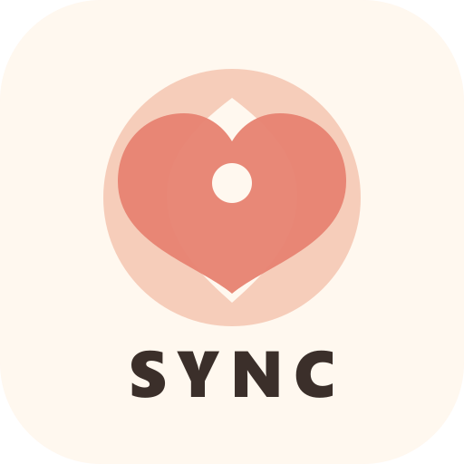
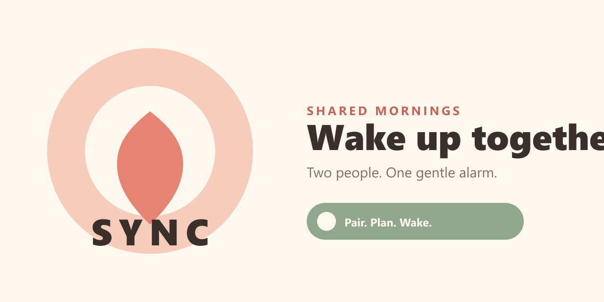

# SYNC

<p align="center">
  
</p>

<p align="center">
  
</p>

**Mornings are brutal enough.** SYNC is an alarm app for two people. You both wake up. From the same alarm. Without cheating.

It is built for two and only two. Once you pair with someone — a six-digit code, no email confirmations, no accounts to forget — you can set alarms for *them* as easily as you set them for yourself. Their phone rings, your message shows up, and you both start moving.

There are no algorithms. There is no "engagement". There is no cloud-rec of your mornings. There is just an alarm.

---

## What it does

- Sign in with **Discord** or **GitHub** — no new account.
- Pair with one person by sending them a six-digit code.
- Set alarms for **you** and **them** separately, with custom wake-up messages.
- Snooze with one tap. Stop requires a long press — because 6am is when accidents happen.
- Reactions on dismiss (❤️ 😴 🔥 ☕) show up in your shared feed.
- A `WAKE THEM` button sends a nudge through the Worker WebSocket/API path while the app is running.
- Stats card: snooze streak, on-time rate, last wake-up — just for the two of you.

Strictly what you need to wake up.

---

## Stack

| Layer            | Picks                                       |
|------------------|---------------------------------------------|
| Frontend         | Flutter 3.22+, Dart 3                       |
| Backend          | Cloudflare Worker + D1 + KV |
| Auth             | Discord OAuth (primary) · GitHub OAuth      |
| Local alarms     | `alarm` (exact alarms, wake-lock)           |
| Notifications    | `flutter_local_notifications`               |
| State            | `flutter_riverpod`                          |
| Push             | Optional provider abstraction; no Google/Firebase app dependencies |
| UX scaling       | `flutter_screenutil` + `intl`               |
| CI               | GitHub Actions → release APK per push       |

The UI uses a warm cream, cocoa, coral, peach, and sage palette with rounded cards and clear touch targets. Local exact alarms remain the reliable alarm mechanism.

> **Push status:** the Android app no longer ships Firebase/Google Messaging dependencies. `PushProvider` is a clean extension point for UnifiedPush, ntfy, or another open transport. Until an Android-native provider is configured, nudges work through the foreground/WebSocket/API path and the app remains fully usable for local exact alarms.

---

## How nudges reach a partner

The Worker API creates the nudge and the WebSocket provider delivers it to a connected app. When the app is foregrounded, the receiver opens the Incoming Nudge surface immediately. A native open-source push provider can implement `PushProvider` for background delivery later; local exact alarms do not depend on that provider.

---

## Setup

### 1. Cloudflare Worker and D1

The app has no Supabase runtime dependency. The Worker uses D1 for users, profiles,
pairings, alarms, logs, nudges, sessions, and OAuth state.

```bash
cd worker
npm install
npx wrangler d1 execute sync-sessions --local --file=schema.sql
npx wrangler dev
```

### 2. Push provider

No Google or Firebase setup is required for builds. `lib/services/push_provider.dart` defines the provider boundary; `LocalPushProvider` is the safe local-only default. A real background nudge provider should be added through this abstraction before release if killed-app delivery is required.

### 3. OAuth

- **Discord**: Developer Portal → New App → OAuth2 → Redirect:
  `https://sync-api.sonoxel-edge.workers.dev/v1/auth/callback`.
- **GitHub**: Settings → Developer settings → New OAuth App → Authorization callback:
  `https://sync-api.sonoxel-edge.workers.dev/v1/auth/callback`.

### 4. Configuration

The app needs only the Cloudflare Worker URL at build time:

```bash
flutter run \
  --dart-define=API_BASE_URL="$API_BASE_URL"
```

For GitHub releases, set `API_BASE_URL` as a repository Actions secret. It
defaults to the D1-native Worker deployment.

### 5. Build

```bash
flutter pub get
flutter run                        # dev
flutter build apk --release \
  --dart-define=API_BASE_URL="$API_BASE_URL" # ship
```

---

## CI / Release

Every push to `main` triggers `.github/workflows/build-apk.yml`. Set the
`SUPABASE_URL` and `SUPABASE_ANON_KEY` Actions secrets once in the repository
settings; the workflow injects them into the release build and fails if either
is absent. It then runs `flutter analyze`, builds the APK, and uploads it as
an artifact named `release-apk`. The build is signed with the debug keystore
as a stop-gap — rotate before publishing to the Play Store.

Releases are tagged by hand (`v1.0.0`, `v1.1.0`, …). To publish one after CI passes:

```bash
gh release create v1.0.0 \
  build/app/outputs/flutter-apk/app-release.apk \
  --title "v1.0.0 — first wake" \
  --notes-file - <<'EOF'
- First public build.
- Discord + GitHub auth.
- Pair with one person. One alarm. No fluff.
- Warm shared-morning UI and local exact alarms.
EOF
```

---

## Project layout

```
lib/
├── main.dart                       # entry, alarm boot, deep-link route
├── models/                         # alarm, profile, pairing, alarm_log, nudge
├── providers/                      # Riverpod: auth, alarm, pairing, connectivity, nudge
├── services/                       # API, AlarmService, Battery, PushProvider
├── screens/                        # splash, login, pair, home, ring, form, reactions, incoming_nudge
├── widgets/                        # shared alarm and input widgets
└── theme/                          # warm shared-morning palette
worker/
├── schema.sql                      # D1 data model
└── src/                            # direct OAuth, API, WebSocket, and D1 routes
android/                            # AndroidX, deep-link, exact-alarm perms
.github/workflows/
└── build-apk.yml                   # release APK per push to main
```

---

## Permissions (Android 12+)

The app asks for `SCHEDULE_EXACT_ALARM` on first launch. If the user denied it, they're sent to system settings with a one-tap path. Without exact alarms, this app is useless — so we surface the permission clearly.

Doze mode: a one-time onboarding dialog explains how to disable battery optimization for SYNC.

iOS: schedules a critical local notification at alarm time as a fallback (Apple does not allow true background alarm ringing).

---

## Privacy

D1 `profiles` stores: username, avatar URL, timezone, sleep status (`awake`/`asleep`), and battery percent.

`alarm_logs` stores: firing, snoozes, dismisses, and reactions — visible to both members of the pair only.

`nudges` stores: who nudged whom and when. Used in-app only; auto-pruned after read.

No analytics. No third-party trackers. No Crashlytics, no Google Analytics SDK. The only data we have is the data you typed in.

---

## License

MIT. Build it, fork it, ship it.
